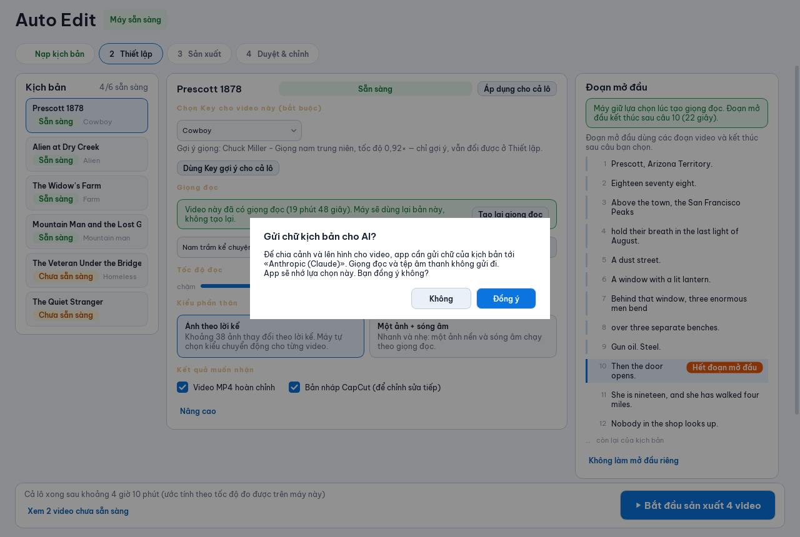
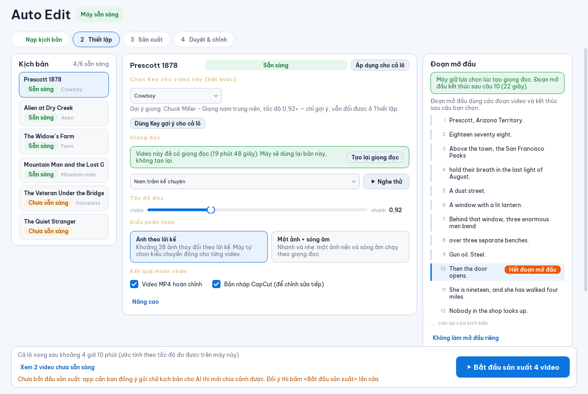
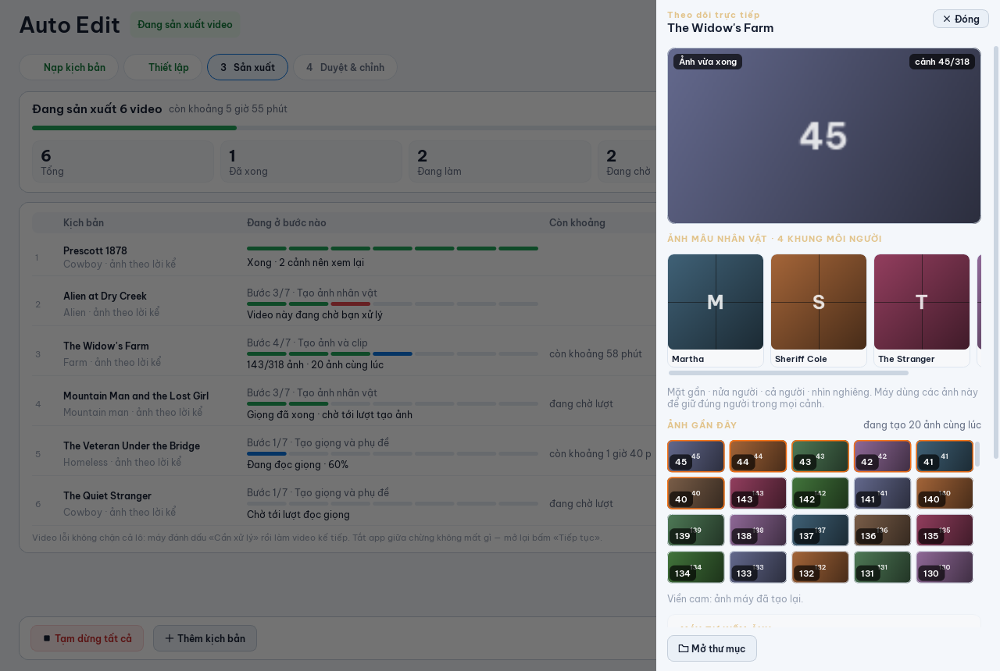

# 03 - Auto Edit (bản 1.3.3, sắp phát hành)

Bạn đưa vào các tệp kịch bản, bấm một nút, máy làm ra video. Mục **«Auto Edit»** nằm ở menu bên trái, ngay dưới **«Tạo giọng»**.

Với mỗi kịch bản, máy tự làm 7 việc: tạo giọng và phụ đề, chia cảnh theo lời, tạo ảnh nhân vật, tạo ảnh và đoạn video, kiểm tra và tạo lại ảnh lỗi, dựng video, xuất kết quả.

Có 4 bước: **Nạp kịch bản → Thiết lập → Sản xuất → Duyệt & chỉnh**.

## Chuẩn bị

1. Mở **G-Labs Studio** và đăng nhập các tài khoản bạn có. Máy chưa cài: bấm nút **«Tải G-Labs Studio»** trên màn Auto Edit, cài, rồi bấm **«Kiểm tra lại»**. Ở bước «Thiết lập», khung «Chung cho cả lô», bấm «+» / «−» ở ô **«Tài khoản trong công cụ tạo ảnh»** cho đúng số tài khoản đang đăng nhập (mặc định là 1).
2. Trong TASL, mở **«Kết nối AI»** và nối một dịch vụ AI.
3. Chuẩn bị kịch bản dạng `.txt` hoặc `.docx`, mỗi tệp là một video.
4. Chừa ổ đĩa: khoảng 10 GB cho mỗi video (số ước, chưa đo thật).
5. Muốn lấy bản nháp CapCut thì dùng CapCut bản 9.7 hoặc 9.8.

Bạn không cần tạo giọng trước. Kịch bản đã có giọng thì máy dùng lại.

## Bước 1 - Nạp kịch bản

1. Bấm **«Auto Edit»**.
2. Kéo các tệp kịch bản vào ô giữa màn hình, hoặc bấm **«Chọn tệp…»** / **«Chọn cả thư mục…»**.
3. Nhìn dòng **«Nơi lưu»**; muốn đổi chỗ thì bấm **«Đổi…»**.
4. Tệp nào báo không dùng được thì bấm **«Bỏ»** ở dòng đó.
5. Bấm **«Tiếp: Thiết lập →»**.

Mỗi kịch bản có một thư mục riêng; trùng tên thì máy thêm số, không ghi đè. Tệp gốc của bạn được giữ nguyên.

<!-- ẢNH CẦN CHỤP: bước Nạp kịch bản, đã thả vài tệp -->

## Bước 2 - Thiết lập

Danh sách kịch bản nằm bên trái; bấm vào một kịch bản để chỉnh.

1. **«Chọn Key cho video này (bắt buộc)»**: Farm, Cowboy, Mountain man, Alien, Homeless, hoặc «Khác» rồi gõ tên.
2. Bấm **«Dùng Key gợi ý cho cả lô»** nếu muốn lấy gợi ý của máy.
3. **«Giọng đọc»**: bạn tự chọn giọng (chưa có giọng mặc định theo Key).
4. **«Tốc độ đọc»**: kéo thanh nếu muốn chậm hoặc nhanh hơn.
5. **«Đoạn mở đầu»**: bấm vào câu mà bạn muốn đoạn mở đầu kết thúc. Ở bản 1.3.3 mọi video đều có đoạn mở đầu; lựa chọn bỏ đoạn mở đầu sẽ có ở bản vá kế tiếp.
6. **«Kiểu phần thân»**: **«Ảnh theo lời kể»** hoặc **«Một ảnh + sóng âm»** (nhanh, nhẹ).
7. **«Kết quả muốn nhận»**: **«Video MP4 hoàn chỉnh»**, **«Bản nháp CapCut (để chỉnh sửa tiếp)»**, hoặc cả hai.
8. **«Áp dụng cho cả lô»**: dùng chung giọng đọc, tốc độ, kiểu phần thân và kết quả cho các video khác. Key và đoạn mở đầu luôn riêng từng video.
9. Khung **«Chung cho cả lô»**: chọn **«Tốc độ tạo ảnh»** (Bình thường, Nhanh, Tối đa) và bấm «+» / «−» ở **«Tài khoản trong công cụ tạo ảnh»** cho đúng số tài khoản đang đăng nhập. Chưa khai thì máy coi là 1 tài khoản (5 ảnh cùng lúc ở mức Tối đa).
10. Video nào còn ghi **«Chưa sẵn sàng»** thì chọn nốt mục còn thiếu.
11. Bấm **«Bắt đầu sản xuất»** ở góc dưới bên phải.

Nút bị mờ thì đọc dòng chữ vàng bên cạnh: nó nói còn thiếu gì. Lần đầu vào Auto Edit, app tự tải phần dựng video; nút sáng lên khi tải xong.

**«Tốc độ tạo ảnh»**: Bình thường, Nhanh, Tối đa ứng với 3, 4, 5 ảnh cùng lúc cho mỗi tài khoản. G-Labs hay báo lỗi thì chọn Bình thường.

<!-- ẢNH CẦN CHỤP: bước Thiết lập, một video đã chọn đủ Key, giọng, kiểu phần thân -->

### Lần đầu: máy hỏi một câu

Máy hỏi bạn có đồng ý gửi **chữ của kịch bản** cho AI để chia cảnh không. Giọng đọc và tệp âm thanh không gửi đi.



- **«Đồng ý»**: bắt đầu; máy nhớ, lần sau không hỏi.
- **«Không»**: máy không bắt đầu và ở lại bước «Thiết lập».



*(Ảnh chụp bằng dữ liệu mẫu.)*

## Bước 3 - Sản xuất

Màn này cho biết mỗi video đang ở bước nào trong 7 bước và còn khoảng bao lâu.

1. Cột **«Tình trạng»**: Đang chờ, Đang làm, Đang tạo lại, Tạm dừng, Cần xử lý, Đã xong, Đã bỏ khỏi lô.
2. **«Theo dõi trực tiếp»**: xem ảnh máy đang tạo.
3. **«Tạm dừng»** / **«Tiếp tục»** cho một video; **«Tạm dừng tất cả»** / **«Tiếp tục tất cả»** cho cả lô.
4. **«Bỏ khỏi lô»** để bỏ một video; lỡ nhầm thì bấm **«Sản xuất lại video này»**.
5. Video báo **«Cần xử lý»**: xem [05 - Khắc phục lỗi](05-khac-phuc-loi.md).
6. Video báo **«Đã xong»**: bấm **«Mở thành phẩm»**.



Trong khung «Theo dõi trực tiếp» bạn thấy ảnh mẫu nhân vật (4 khung mỗi người: mặt gần, nửa người, cả người, nhìn nghiêng), các ảnh vừa tạo xong (viền cam là ảnh máy đã tạo lại), và số ảnh máy đã kiểm / tạo lại.

Một video lỗi không làm dừng cả lô: máy đánh dấu «Cần xử lý» rồi làm video kế tiếp.

Muốn đổi ảnh sau khi xong: xem [04 - Duyệt và chỉnh](04-duyet-va-chinh.md).

## Cho kênh nuôi: video một tấm ảnh

Video chỉ cần giọng đọc chạy trên một ảnh nền:

1. Ở bước «Nạp kịch bản», thêm kịch bản như thường.
2. Ở bước «Thiết lập», mục **«Kiểu phần thân»** chọn **«Một ảnh + sóng âm»**.
3. Mục **«Đoạn mở đầu»**: chọn câu kết thúc đoạn mở đầu như thường (bản 1.3.3 luôn làm đoạn mở đầu).
4. Chọn Key và giọng đọc, rồi bấm **«Bắt đầu sản xuất»**. Lúc này máy mới tạo thư mục cho từng video (đừng tự tạo trước, máy sẽ đặt tên khác).
5. Trong lúc máy còn đọc giọng và chia cảnh, bỏ **một ảnh nền** (png hoặc jpg) vào thư mục lưu › tên video › `03_Hinh_anh` (máy lấy ảnh đầu tiên theo tên tệp).

Thư mục `03_Hinh_anh` trống thì video dừng ở «Cần xử lý»: bỏ ảnh nền vào rồi bấm «Thử lại». Kiểu này chưa đổi ảnh từng cảnh ở «Duyệt & chỉnh» được. Bản này vẫn gửi chữ kịch bản cho AI chia cảnh như kiểu thường (tốn tiền AI gần bằng); bản vá kế tiếp sẽ bỏ bước này cho kiểu một ảnh, hỏi ảnh nền ngay ở bước «Thiết lập» và cho bỏ đoạn mở đầu.

## Tắt app giữa chừng

1. Máy hỏi: «Đang làm dở N video. Tắt thì lần sau làm tiếp, không mất gì.»
2. Bấm **«Tắt»** hoặc **«Ở lại»**.
3. Mở lại app, máy **không tự chạy**. Vào «Auto Edit», bấm **«Tiếp tục»** trên thanh vàng; chưa muốn thì bấm **«Để sau»**.

## Thư mục của một video

```
<Nơi lưu>\<Tên kịch bản>\
  01_Kich_ban     bản chép kịch bản của bạn
  02_Video_goc    video quay sẵn (nếu có)
  03_Hinh_anh     ảnh bạn tự đưa vào (nếu có)
  04_Am_thanh     giọng đọc, phụ đề
  05_Video_mau    video mẫu để tham khảo (nếu có)
  06_AI_tao       ảnh nhân vật, ảnh và đoạn video do máy tạo
  07_Ket_qua      01_Video_nhap · 02_Video_hoan_chinh · 03_Du_an_CapCut
```

Video MP4 hoàn chỉnh nằm ở `07_Ket_qua\02_Video_hoan_chinh`.

## Một video 2 giờ mất bao lâu?

Chưa có số đo bằng Auto Edit. Lần chạy tay thử một video dài 2 giờ 10 phút, máy làm khoảng 2 giờ 5 phút, trong đó tạo ảnh khoảng 60 phút. Trên màn hình, máy luôn ghi thời gian kèm chữ «khoảng».

## Lưu ý khi đăng YouTube

- Mỗi kịch bản là một câu chuyện riêng; đừng dùng lại một nội dung cho nhiều video.
- Hình do AI tạo trông như thật thì nên bật mục khai báo có dùng AI khi đăng. *(Chưa đối chiếu với trang chính thức của YouTube; bạn nên tự kiểm lại.)*
