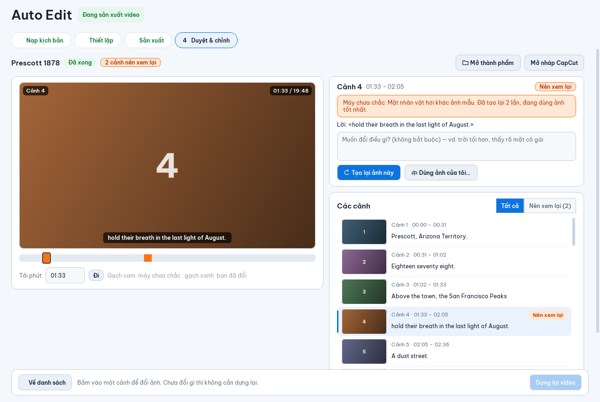
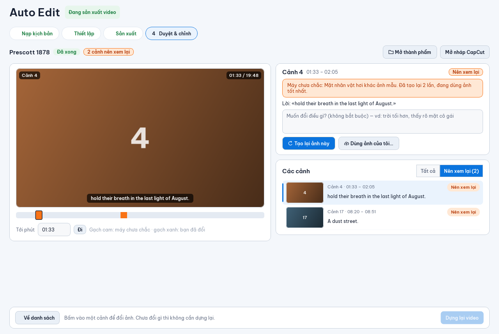
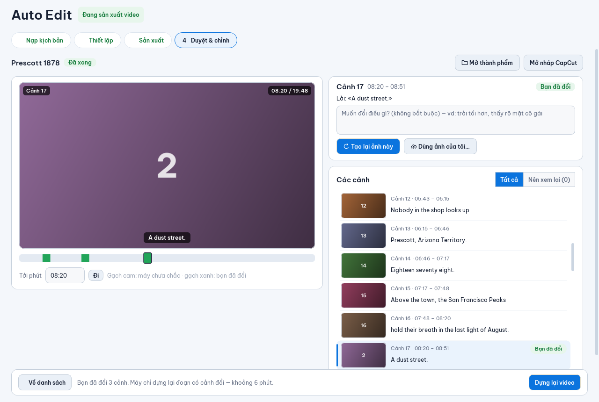
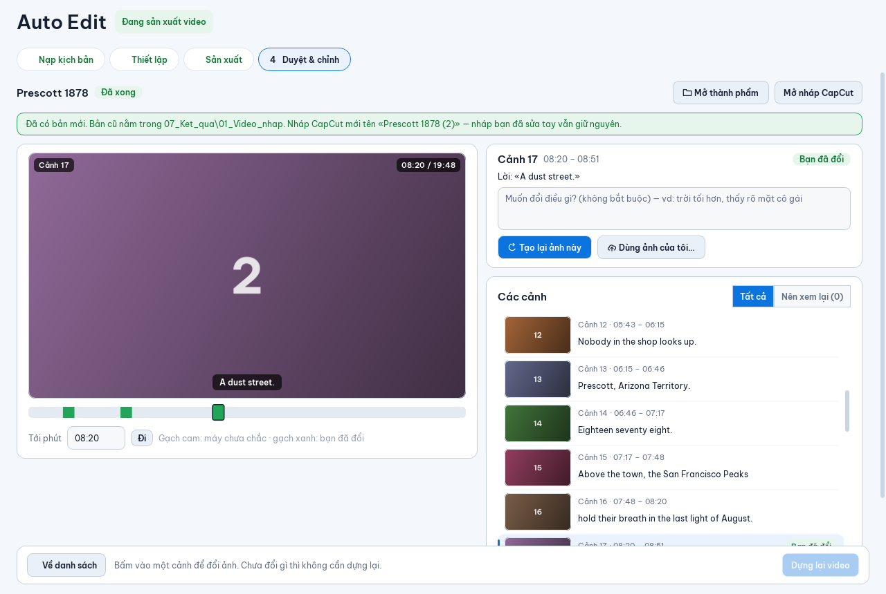

# 04 - Duyệt & chỉnh (từ bản 1.3.3)

Dùng khi video đã xong mà bạn muốn đổi ảnh của vài cảnh. Video ghi «Xong · N cảnh nên xem lại» là video có ảnh máy chưa chắc; xem thấy ổn thì dùng luôn.

1. Ở dòng video đã xong, bấm **«Duyệt & chỉnh»**.

2. Bấm **«Nên xem lại (N)»** để chỉ hiện những cảnh máy chưa chắc.

3. Bấm vào cảnh muốn đổi ảnh.
4. Nếu muốn, gõ điều cần đổi vào ô ghi chú, ví dụ: *trời tối hơn, thấy rõ mặt cô gái*.
5. Bấm **«Tạo lại ảnh này»**: cảnh được đánh dấu là đã đổi (gạch xanh). Ảnh mới **chưa** hiện ngay; máy tạo ảnh mới trong lượt «Dựng lại video».
6. Có sẵn ảnh trên máy thì bấm **«Dùng ảnh của tôi…»** thay cho bước 5.
7. Làm lại bước 3–6 cho các cảnh khác.
8. Đánh dấu xong mọi cảnh rồi mới bấm **«Dựng lại video»** — một lần cho tất cả cảnh đã đổi. Máy tạo ảnh mới rồi dựng lại.

9. Chờ dòng báo **«Đã có bản mới.»**

10. Bấm **«Mở thành phẩm»** để xem video, hoặc **«Mở nháp CapCut»** để sửa tiếp trong CapCut. Ảnh mới chưa ưng thì làm lại từ bước 3.

*(Ảnh chụp bằng dữ liệu mẫu.)*

## Điều nên biết

- Trên thanh thời gian, gạch cam là cảnh máy chưa chắc, gạch xanh là cảnh bạn đã đổi.
- Muốn nhảy tới một phút nào đó, gõ số phút vào ô **«Tới phút»** rồi bấm **«Đi»**.
- Máy chỉ dựng lại khúc 10 phút có cảnh đổi, không dựng lại cả video. Thời gian dựng lại chưa đo.
- Chưa đổi cảnh nào thì không cần dựng lại.
- **Ảnh của đoạn mở đầu chưa tạo lại riêng được trong app**: muốn thay thì bấm «Mở nháp CapCut» và thay trong CapCut.
